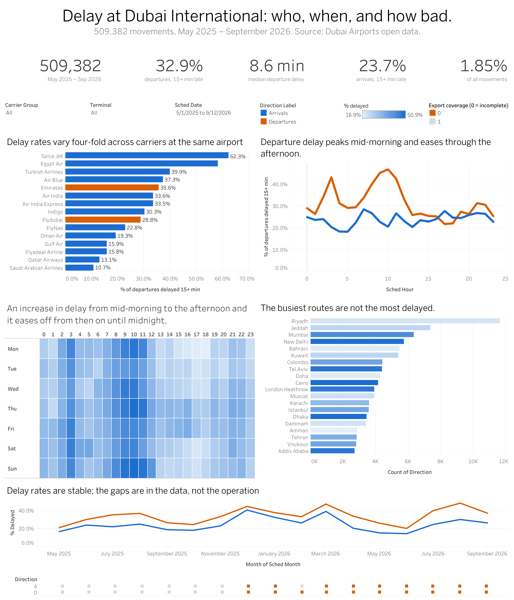
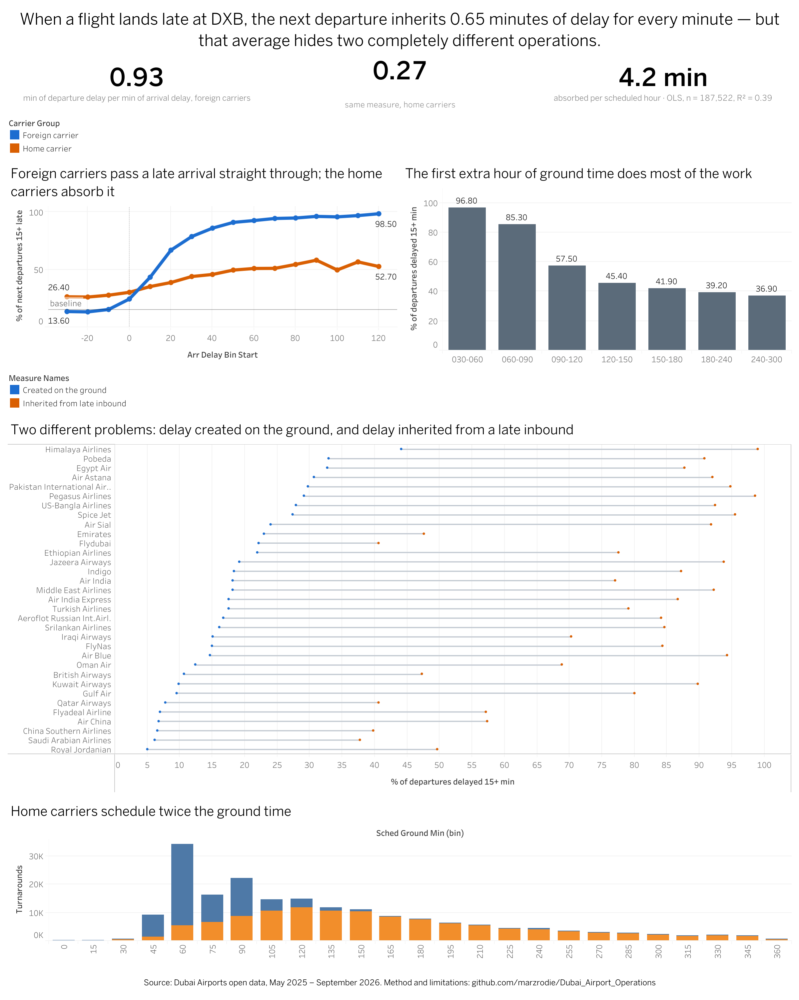

# Delay Propagation at Dubai International (DXB)

***When a flight lands late at DXB, how much of that delay does the next
departure inherit — and what stops it?***

An end-to-end analysis of 509,382 flight movements: *raw CSV → PostgreSQL →
regression → published dashboards*.

**The answer in one line:** a minute of arrival delay becomes **0.65 minutes**
of departure delay — but that average conceals two entirely different
operations at the same airport. Foreign carriers pass through **0.93** minutes
per minute; Emirates and Flydubai pass through **0.27**. The difference is
scheduled ground time, and it is buyable.

---

## Dashboards

**[DXB On-Time Performance](https://public.tableau.com/views/DXBFlightOperations/DXBOn-TimePerformance)** — *what the delay picture looks
like: by carrier, hour, weekday, terminal and route.*



**[Delay Propagation & Turnarounds](https://public.tableau.com/views/DXBFlightOperations/DelayPropagation)** — *why departures run late,
and what fixes it.*



---

## The business question

When an aircraft lands late at Dubai International, the delay does not stop
there. The same airframe turns around and flies out again, often within the
hour. An operations team needs three things:

1. How much of the arrival delay *survives* the turnaround?
2. How much scheduled ground time is *enough* to absorb it?
3. When a flight leaves late, was the delay **inherited** from the inbound
   aircraft, or **created** on the ground at DXB?

The third question is the one that decides where to spend money. The first two
are prerequisites for answering it.

---

## Key findings

**1. Departure delay is the bigger problem.** *32.9%* of departures leave 15 or
more minutes late, against *23.7%* of arrivals. The median departure is 8.6
minutes late; the median arrival is 1.8 minutes *early*. **DXB receives
aircraft roughly on time and dispatches them late.**

**2. A minute of arrival delay becomes 0.65 minutes of departure delay**, after
controlling for scheduled ground time, carrier group, time of day and terminal
changes. *Each additional hour of scheduled ground time absorbs 4.2 minutes.*

**3. That single figure hides two airports.** Fitting the model separately:

| Carrier group | n | Pass-through | R² |
|---|---|---|---|
| Foreign | 70,719 | **0.934** | 0.701 |
| Home *(Emirates, Flydubai)* | 116,803 | **0.274** | 0.110 |

The cause is schedule design, not ground performance: home carriers plan a
median **150 minutes** on the ground, foreign carriers **70**.

*The R² gap is itself a finding. For foreign carriers the turn is nearly
mechanical — arrival delay and ground time explain 70% of departure-delay
variance. For home carriers they explain 11%, which locates most of their
departure delay in factors this data cannot see.*

**4. Buffer works, with sharply diminishing returns and a hard floor.** For
arrivals already more than 15 minutes late:

| Scheduled ground time | Departures still 15+ late | Delay recovered |
|---|---|---|
| 30–60 min | **96.8%** | −34% |
| 60–90 | **85.3%** | −12% |
| 90–120 | **57.5%** | 17% |
| 120–150 | **45.4%** | 36% |
| 150–180 | **41.9%** | 49% |
| 180–240 | **39.2%** | 60% |
| 240–300 | **37.0%** | 68% |

The first extra hour buys most of the recovery. Past 180 minutes the rate
settles near **37–40% and stops improving** — *that floor is delay generated at
DXB rather than inherited.*

*Negative recovery in the first two bands is not a sign error: those turns
depart later relative to schedule than they arrived, because the ground process
overruns the compressed time available.*

**5. Airlines fail in three distinct ways.** Splitting each carrier's
departure-delay rate by the state of the inbound aircraft separates delay
*created* from delay *inherited*:

| Pattern | Carrier | After on-time arrival | After late arrival |
|---|---|---|---|
| *Ground process* | SpiceJet | **27.4%** | 95.5% |
| | Egypt Air | **32.7%** | 87.7% |
| *No schedule slack* | Kuwait Airways | 9.9% | **89.8%** |
| | Jazeera Airways | 19.2% | **93.8%** |
| | Air Blue | 14.7% | **94.3%** |
| *Both controlled* | Saudia | 6.2% | 37.8% |
| | Qatar Airways | 7.8% | 40.6% |
| *Buffered hub* | Emirates | 23.0% | 47.6% |
| | Flydubai | 22.2% | 40.6% |

***Three problems requiring three different responses.*** A carrier with a high
baseline needs ground-process attention; one with a low baseline and a large
gap needs schedule slack. Treating them alike wastes effort on both.

---

## Recommendations

**Set a minimum 120 minutes of ground time for turns exposed to long-haul
inbound delay.** The recovery curve is steep to that point and flat past 180,
so the first extra hour buys most of the benefit at the lowest schedule cost.

**Diagnose before prescribing.** Use the baseline-versus-inherited split to
classify each carrier before intervening. The three regimes above look
identical in a conventional on-time-performance table.

**Target the ~38% floor with ground operations, not scheduling.** No amount of
buffer moves it, which means stand allocation, crew, cargo or handling — *none
of which this data can separate, and all of which the airport already
measures.*

---

## The data

| | |
|---|---|
| **Source** | Dubai Airports flight information *(arrivals and departures exports)* |
| **Extract date** | 12 September 2026 |
| **Period** | Flights scheduled 1 May 2025 – 12 September 2026 *(479 days)* |
| **Raw records** | 254,154 arrivals · 255,759 departures |
| **After de-duplication** | 509,382 movements |
| **Turnarounds constructed** | 230,928 |
| **Coverage** | 158 carriers · 83 aircraft types · 3,800 airframes · 354 stations |
| **Licence** | [Dubai Open Data Licence](https://data.dubai/en/l/463958) — commercial and non-commercial use permitted, attribution required |

> **Structurally absent:** delay cause codes, weather, passenger and cargo
> loads, crew rostering, stand-allocation decisions. *These absences are
> load-bearing for interpretation — see **Limitations**.*

---

## Tools

**PostgreSQL 16** + **pgAdmin** — storage and transformation
**Python** *(pandas, statsmodels, matplotlib)* in **VS Code** — analysis
**Tableau Public** — dashboards
**Git** · **jupytext** — version control and notebook/script pairing

---

## Pipeline

Three schemas, one script per transformation, no step modifying a prior step's
output in place:

| Schema | Contents | Built by |
|---|---|---|
| `raw` | Verbatim CSV copy, every column `text` | `01_schemas_and_raw.sql` |
| `staging` | Typed, de-duplicated, column-aligned; one row per flight | `03_staging_arrivals.sql`, `04_staging_departures.sql` |
| `analytics` | `dim_airline`, `movements`, `monthly_coverage`, `turnarounds` | `05_movements.sql`, `06_turnaround.sql` |
| `extract` | Star-schema CSVs for Tableau | `07_tableau_extracts.sql` |

*Holding the raw layer as text defers all type coercion into version-controlled
SQL, so a parse failure becomes a reviewable diff rather than a silent
import-time null.*

**Run order:** `01` → import both CSVs → `03` → `04` → `05` → `06` → `07` →
notebook.

### The turnaround join

The core of the analysis. Every movement is ordered by aircraft registration
and actual block time; a window function pairs each arrival with the next
movement of that airframe:

```sql
LEAD(...) OVER (PARTITION BY registration ORDER BY actual_time, direction)
```

A pair qualifies when the next movement is a departure, neither is a delay
outlier, and ground time falls within 20 minutes to 24 hours.

**95.3% of arrivals pair cleanly.** The remainder is itemised rather than
hand-waved:

| Outcome | n | % |
|---|---|---|
| **Valid turn** | 230,928 | **95.3** |
| Ground time > 24 h *(parked, not turning)* | 6,496 | 2.7 |
| Next movement is another arrival *(departure absent from export)* | 3,505 | 1.4 |
| Delay outlier excluded | 1,149 | 0.5 |
| Last movement for that airframe | 329 | 0.1 |
| Ground time < 20 min *(implausible)* | 3 | 0.0 |

---

## Cleaning decisions

*Each is numbered in the SQL at the point of application.*

| # | Issue | Resolution |
|---|---|---|
| **D1** | 531 flights exported twice under one ID, differing load timestamps | `DISTINCT ON (id) ORDER BY load_timestamp DESC` |
| **D2** | Empty strings in numeric and timestamp columns | `NULLIF(TRIM(x), '')` before cast |
| **D3** | Terminal stored as both `'3'` and `'3 '` | `TRIM` — three terminals had looked like six |
| **D4** | Carrier name variants *("Flydubai" / "Fly dubai")* | `dim_airline` takes the modal name per ICAO code; no hard-coded mapping |
| **D5** | Codeshare numbers tab-delimited inside one cell | `string_to_array(x, E'\t')` |
| **D6** | Direction-specific column names prevent a union | Both staging tables aligned to block-time semantics |
| **D7** | `actualtakeofftime` null for 56% of departures | Off-block time is authoritative for delay; take-off used only for taxi-out |
| **D8** | Check-in desk allocation null for 26% of departures | Retained, unused in this analysis |
| **D9** | 83 flight IDs collide across the two exports on unrelated flights | Composite key `(direction, flight_id)` |
| **D10** | Implausible turnaround windows | Bounded to 20 min – 24 h; excluded counts reported above |
| **D11** | Delays outside −60 to +600 min *(date-roll artefacts)* | Flagged `delay_outlier`, excluded from means |
| **D12** | Aircraft towed between terminals mid-turn | Flagged `terminal_changed` *(19,020 turns)*; retained |
| **D13** | PostgreSQL exports booleans as `t`/`f` | Cast to `1`/`0` — BI tools read `t`/`f` as text and every `SUM()` silently breaks |
| **D14** | Terminal values are mostly digits | Emitted as `T1`/`T2`/`T3`/`PT` — as bare digits, BI tools type the column numeric and null the ~8,200 `PT` movements |
| **D15** | `terminal = 'No'` on 2 arrival records | Retained and documented. *2 rows cannot move a rate, and a silent exclusion is worse than a known artefact* |
| **D16** | `sched_ground_min` is negative where a departure was scheduled before its inbound was due | Real, not corrupt — a consequence of re-planned rotations. Bounded to ≥ 0 for distribution charts |

### Coverage assessment

The export is incomplete in **two distinct modes**, so the test has two parts:

- **Missing days** — December 2025 holds 15 of 31 calendar days, at normal
  daily volume.
- **Thin days** — March–August 2026 hold *every* calendar day but average
  260–500 movements per day against 614–669 in complete months.

`monthly_coverage.coverage_complete` requires full day coverage **and** ≥ 550
movements/day. **Seven months qualify: May–November 2025.** *87,511
turnarounds (37.9%) fall in months that fail.*

> **Conditional rates remain interpretable; counts and volume trends do not.**
> The dashboard shows this directly — a coverage strip sits beneath the monthly
> trend line, so an orange block appears under any stretch the export
> under-reports. *A cancellation spike of 1,499 in March 2026 (against a
> 100–250 monthly norm) coincides with the thin-day period and is not
> disentangled here.*

---

## Metric definitions

| Variable | Definition |
|---|---|
| `delay_min` | Actual − scheduled **block** time *(in-block for arrivals, off-block for departures)*; negative is early |
| `is_delayed_15` | `delay_min > 15` — the industry OTP convention |
| `delay_outlier` | `delay_min < −60` or `> 600` |
| `taxi_min` | *Arrivals:* in-block − landing. *Departures:* take-off − off-block |
| `is_operated` | Non-null actual time and a terminal status |
| `sched_ground_min` | Scheduled off-block − scheduled in-block |
| `actual_ground_min` | Actual off-block − actual in-block |
| `delay_recovered` | `arr_delay_min − dep_delay_min` — positive means minutes clawed back |
| **Pass-through** | Minutes of departure delay generated *per minute* of arrival delay |
| **Baseline rate** | Share of departures 15+ late ***after an on-time arrival*** — the inherited component held at zero |

---

## Model specification

OLS with HC1 robust standard errors, *n = 187,522*, **R² = 0.392**:

```text
dep_delay_min ~ arr_late + arr_early + sched_ground_hr
                + C(carrier_group) + C(hour_band) + C(terminal_changed)
```

| Term | Coefficient | SE |
|---|---|---|
| `arr_late` | **0.645** | 0.005 |
| `arr_early` | 0.097 | 0.006 |
| `sched_ground_hr` | **−4.222** | 0.060 |
| Home carrier | +3.100 | 0.136 |
| Afternoon *(12–17)* vs night | −9.343 | 0.168 |
| Evening *(18–23)* vs night | −5.380 | 0.159 |
| Terminal changed | −3.359 | 0.213 |

Arrival delay enters as two one-sided terms, `arr_late = max(d, 0)` and
`arr_early = max(−d, 0)`. *The 6.6 : 1 coefficient ratio confirms an asymmetry
a single linear term would hide: arriving an hour early does not buy back what
arriving an hour late costs.*

Sample restricted to `dep_delay_min ∈ [−60, 300]` and `sched_ground_min ∈
[20, 360]`.

---

## Limitations

**No delay causes.** The data records *that* a flight was late, not *why*.
Weather, air traffic control, crew and cargo are invisible. ***"Created at DXB"
means "not inherited from the inbound aircraft" — not "the airline's fault".***
The baseline rate is a residual, and attributing it to ground handling is an
interpretation the data supports only weakly.

**Selection in pair construction.** 4.7% of arrivals do not pair, of which 1.4%
fail because the matching departure is absent from the export. *Absence is
unlikely to be independent of disruption, so pass-through is plausibly a mild
**underestimate**.*

**Coverage.** 37.9% of turns sit in months failing the completeness test.
Conditional rates hold under missing-at-random within month; counts and trends
do not without the filter.

**Average, not extreme.** OLS estimates a conditional mean over a heavy-tailed
distribution, so it characterises the typical turn rather than the disruption
days that matter most operationally.

**Measurement.** Ground time for the 19,020 towed turns includes tow and
repositioning, overstating the productive turn.

---

## What I would do next

1. **Join hourly weather for OMDB** *(Open-Meteo or NOAA)* — the single largest
   missing variable, and the one that would separate weather delay from process
   delay.
2. **Quantile regression at τ = 0.75 and 0.90** — to characterise the
   disruption tail the mean understates.
3. **Stand and gate utilisation** from the parking-position and gate fields,
   already ingested but unused here.
4. **Recovery-window analysis** — does delay dissipate or accumulate across
   successive rotations of the same airframe within an operating day?

---

## Engineering notes

*Four things went wrong. Each is recorded because the failure mode generalises.*

**A pipeline that half-succeeded.** The turnaround table came back empty.
Cause: `05_movements.sql` ran before `staging.arrivals` was populated, so the
union produced a departures-only table. No error was raised and every
downstream step consumed the truncated result. **Fix:** a precondition check at
the head of `05` that raises an exception if either staging table is empty.
*Silent partial success is the more dangerous failure mode in an ELT pipeline,
and a four-line assertion is cheap insurance.*

**Booleans that were not booleans.** PostgreSQL's CSV export writes `t`/`f`.
Tableau typed those columns as text, and every `SUM()` over them failed with an
error that named nothing useful. **Fix:** cast to `1`/`0` in the extract layer
*(D13)*.

**A column that was mostly numbers.** `terminal` holds `1`, `2`, `3`, `PT`.
Mostly digits, so Tableau typed it numeric and turned every `PT` into Null —
silently dropping about 8,200 movements. Changing the type after import does
not recover them, because the values are discarded during the parse. **Fix:**
emit `T1`/`T2`/`T3`/`PT` so the column cannot be mistyped *(D14)*.

**A rounding bug that produced suspiciously round numbers.** The buffer table
rounded a proportion to one decimal *before* converting to a percentage, so
0.853 became 0.9 and printed as "90%". Every band landed on a multiple of ten —
which is what gave it away. *Real data does not produce seven round numbers in
a row.* **Fix:** convert, then round. Corrected figures are in **Key findings
#4**.

---

## Skills demonstrated

*Where to look, if you are assessing specific competencies.*

| Skill | Where it appears |
|---|---|
| **Window functions** | `06_turnaround.sql` — `LEAD()` over `PARTITION BY registration ORDER BY actual_time` pairs each arrival with its next departure. The entire analysis rests on this one construct |
| **Dimensional modelling** | `07_tableau_extracts.sql` — star schema with keys-only fact tables and conformed `dim_airline` / `dim_station`, halving extract size and giving the BI layer a clean join path |
| **ELT architecture** | Three schemas *(`raw` → `staging` → `analytics`)*, one script per transformation, no in-place mutation. Raw held as `text` so type coercion is reviewable SQL rather than silent import behaviour |
| **Defensive SQL** | `DISTINCT ON` for snapshot de-duplication *(D1)*, composite keys for cross-file ID collisions *(D9)*, `DO $$ … RAISE EXCEPTION` precondition guards in `05_movements.sql` |
| **Regression analysis** | `python/delay_cascade.py` — OLS with HC1 robust standard errors, one-sided variable construction to capture asymmetric response, stratified fits by carrier group, explicit reasoning about what the R² gap means |
| **Statistical honesty** | Selection in pair construction quantified and signed *(4.7% unpaired, bias direction stated)*; missing-at-random reasoning for the coverage gaps; conditional-mean limitation named with the quantile-regression remedy |
| **Data-quality engineering** | A two-part coverage test catching both missing days and thin days; a documented outlier policy; four type-coercion traps found and fixed at source *(D13–D16)* |
| **Python tooling** | `db.py` connection module with `.env` credential separation; `# %%` cell-scripts jupytext-paired to notebooks so code diffs cleanly while outputs stay viewable |
| **BI and visual design** | Two Tableau Public dashboards; dumbbell chart via synchronised dual axis *(the only legitimate use in the project)*; colourblind-validated palette; a coverage strip that makes the data's own gaps visible rather than hiding them |
| **Communication** | Every chart title states a finding rather than naming a variable; tooltips written as sentences; recommendations tied to a specific number with a stated cost |

---

## Reproduction

```bash
git clone https://github.com/marzrodie/Dubai_Airport_Operations.git
cd dxb_ops
conda activate dxb_ops                      # the Python environment
cp .env.example .env                        # add your PostgreSQL password
python -m pip install -r requirements.txt
python python/db.py                         # connectivity check
```

Create a PostgreSQL 16 database named `dxb_ops` *(unrelated to the conda
environment of the same name)*. Run the SQL in order: `01` → CSV import →
`03` → `04` → `05` → `06` → `07`. Each script ends with validation queries
whose expected output is stated in its header comment.

> **In pgAdmin's Query Tool, ensure no text is selected before running a
> script** — a selection executes in place of the whole file, which is how the
> half-populated pipeline above came about.

Notebooks are jupytext-paired with `python/`; run `python -m jupytext --sync`
before committing. Credentials live in `.env`, which is git-ignored;
`.env.example` documents the required variables.

```text
dxb_ops/
├── sql/
│   ├── 01_schemas_and_raw.sql      schemas + raw landing tables
│   ├── 03_staging_arrivals.sql     typed, de-duplicated arrivals
│   ├── 04_staging_departures.sql   typed, de-duplicated departures
│   ├── 05_movements.sql            union, airline dimension, coverage flags
│   ├── 06_turnaround.sql           the window-function pairing
│   └── 07_tableau_extracts.sql     star-schema CSVs for Tableau
├── python/
│   ├── db.py                       connection helper
│   └── delay_cascade.py            cascade, regression, buffer, decomposition
├── notebooks/                      paired .ipynb with saved outputs
├── reports/figures/                charts and dashboard screenshots
└── data/
    ├── processed/                  summary tables
    └── tableau/                    extract CSVs (fct_* git-ignored)
```

---

## Licence and attribution

**Data source:** Dubai Airports flight information *(arrivals and departures)*,
obtained from Dubai Pulse and used under the
**[Dubai Open Data Licence](https://data.dubai/en/l/463958)**, which grants a
worldwide, royalty-free, non-exclusive licence for both commercial and
non-commercial use, subject to attribution.

> **This project is not affiliated with, endorsed by, or associated with Dubai
> Airports, the Dubai Government or any Dubai Government Entity.** The analysis,
> interpretations, recommendations and any errors are the author's alone. Source
> data is attributed as the licence requires; no endorsement of the findings is
> implied or claimed.

**Code** in this repository is released under the MIT Licence. **Extract CSVs**
under `data/tableau/` remain governed by the Dubai Open Data Licence above.

---

## Author

**Rodwell Marimo** — Dubai, UAE

[GitHub](https://github.com/marzrodie) ·
[Tableau Public](https://public.tableau.com/app/profile/rodwell.marimo) ·
[LinkedIn](https://www.linkedin.com/in/rodwell-marimo-b824846a/)
